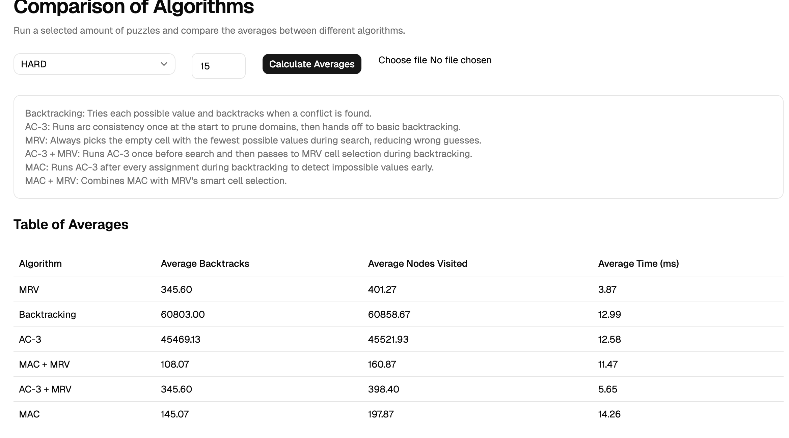

# Sudoku Solver: Comparing Constraint Satisfaction Algorithms

[](https://openjdk.org/)
[](https://spring.io/projects/spring-boot)
[](https://react.dev/)
[](https://www.typescriptlang.org/)

**Live app:** https://sudoku-frontend-1079750265164.europe-west2.run.app

**API docs (Swagger):** https://sudoku-api-1079750265164.europe-west2.run.app/swagger-ui/index.html

A full-stack application for solving and benchmarking Sudoku puzzles using different constraint satisfaction and search techniques — plain backtracking, AC-3, MRV, MAC, and hybrids. The frontend lets you solve individual puzzles or run bulk benchmarks to compare algorithm performance visually.



## What this project is about

Sudoku is a Constraint Satisfaction Problem, which makes it a good testbed for comparing classical AI search techniques. Each algorithm is implemented behind a common `SudokuAlgorithm` interface (strategy pattern) so they can be swapped and benchmarked on the same puzzles under identical conditions. Metrics tracked: **backtracks**, **nodes visited**, and **runtime**.

## Results

Averaged over 50 generated puzzles per difficulty, plus 43 externally sourced hard puzzles.

| Algorithm       | Easy BT | Medium BT | Hard BT   | External BT  | Hard vs Baseline |
|-----------------|--------:|----------:|----------:|-------------:|-----------------:|
| Backtracking    |   21.42 |    353.62 |   124,202 |   ~7,300,000 |    baseline      |
| AC-3            |       0 |     ~43.5 |   101,721 |   ~7,282,557 |    −18.1%        |
| MRV             |       0 |      3.58 |    199.10 |    ~32,412   |    −99.84%       |
| AC-3 + MRV      |       0 |      3.58 |    199.10 |    ~32,412   |    −99.84%       |
| MAC             |       0 |      0.24 |    106.60 |    ~46,534   |    −99.91%       |
| **MAC + MRV**   |   **0** |  **0.84** | **63.26** | **~13,169**  |  **−99.95%**     |

*BT = average backtracks. Lower is better.*

**Key finding:** MAC + MRV was the strongest solver overall, reducing backtracks on hard puzzles by 99.95% vs the baseline. A single AC-3 preprocessing pass was effectively redundant once MRV was in place — AC-3 + MRV and MRV alone produced identical backtrack counts across every difficulty. The takeaway: constraint propagation only pays off when maintained throughout search (MAC), not just as preprocessing.

## Tech stack

- **Core solver library** — Java 21, JUnit 5, JaCoCo (coverage), Checkstyle, SpotBugs
- **API** — Spring Boot 3, REST, OpenAPI/Swagger, multipart file upload
- **Frontend** — React 18, TypeScript, Vite, Recharts
- **CI** — build, test, coverage, and static analysis pipeline

## Architecture

```
┌─────────────────┐      HTTP       ┌──────────────────┐              ┌─────────────────┐
│  React frontend │ ──────────────▶ │  Spring Boot API │ ───────────▶ │  sudokuproject  │
│  (Vite + TS)    │  /api/sudoku    │                  │   depends    │  (core library) │
└─────────────────┘                 └──────────────────┘              └─────────────────┘
                                                                             │
                                                                             ▼
                                                              SudokuAlgorithm (strategy)
                                                              ├─ Backtracking
                                                              ├─ AC-3
                                                              ├─ MRV
                                                              ├─ AC-3 + MRV
                                                              ├─ MAC
                                                              └─ MAC + MRV
```

## Running locally

**Prerequisites:** Java 21, Maven 3.9+, Node.js 20+.

**1. Install the core library into your local Maven repo:**
```bash
cd product/sudokuproject
mvn clean install
```

**2. Start the API:**
```bash
cd ../sudoku-api
mvn spring-boot:run
```
API runs on `http://localhost:8080`. Swagger UI at `http://localhost:8080/swagger-ui/index.html`.

**3. Start the frontend (in a second terminal):**
```bash
cd product/sudoku-frontend
npm install
npm run dev
```
Frontend runs on `http://localhost:5173` and proxies `/api` requests to the backend.

## Using the app

- **Solver tab** — generate a puzzle at a chosen difficulty, pick an algorithm, and solve. Or upload your own puzzle as an 81-character `.txt` file (digits `1-9`, `0` or `.` for empty).
- **Statistics tab** — benchmark multiple algorithms against generated or uploaded puzzles, view side-by-side charts of backtracks, nodes visited, and runtime.

**Bulk upload format:** one 81-character puzzle per line.

## Repository structure

| Path | Description |
|------|------|
| `product/sudokuproject` | Core Java library: `SudokuBoard`, `SudokuPuzzle`, generators, and all solver implementations. Full unit test suite with JaCoCo, Checkstyle, SpotBugs. |
| `product/sudoku-api` | Spring Boot REST API: generate, solve, benchmark, file upload endpoints. |
| `product/sudoku-frontend` | React + TypeScript UI with solver and comparison views. |

## Running with Docker

Requires Docker Desktop. From the `product/` directory:

```bash
docker compose up --build
```

This starts the API and the frontend (nginx). Frontend at http://localhost:5173, API at http://localhost:8080.

## Command-line runner

For quick performance checks without the API/frontend:
```bash
cd product/sudokuproject
mvn compile
java -cp target/classes fyp.sudoku.SudokuMain
```

Run tests and coverage:
```bash
mvn verify
```

## What's next

- Add a GitHub Actions CI/CD pipeline (build, test, deploy)
- Add SAT-solver comparison as a baseline for the hardest known puzzles

---

Built as my final year project at Royal Holloway, University of London.
